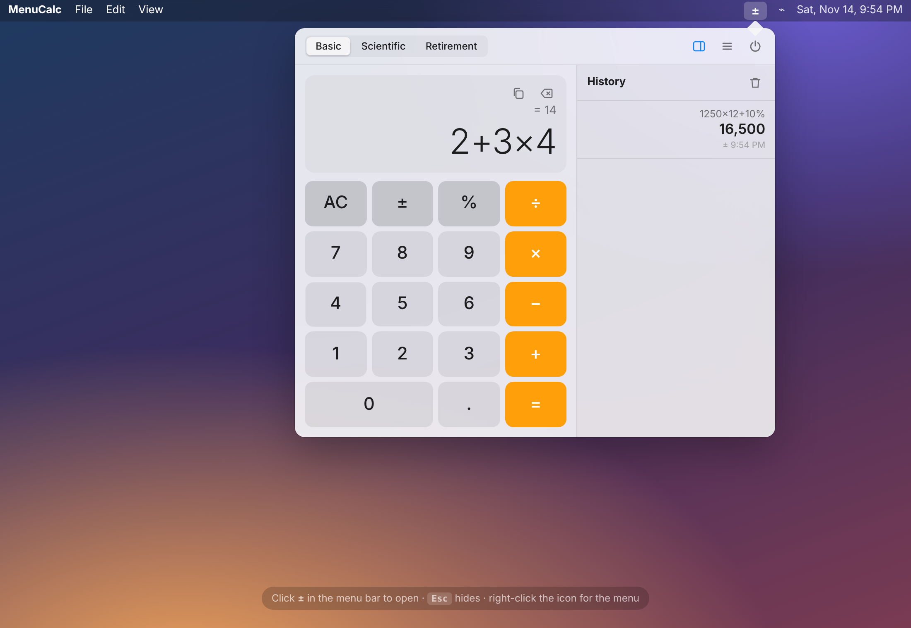
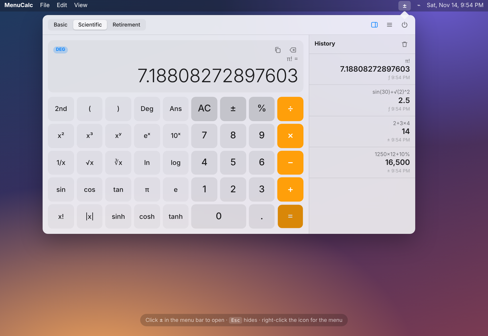
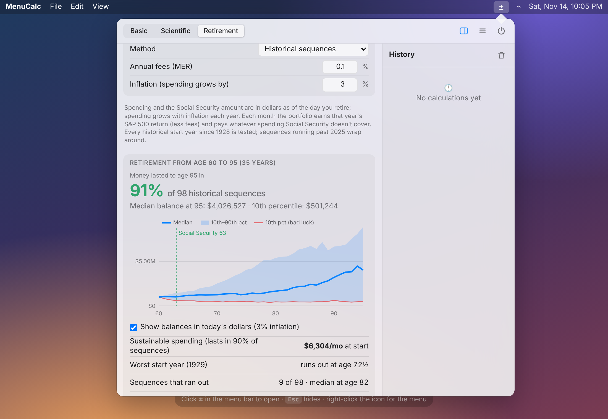

# MenuCalc (web)

A menu-bar-style calculator that runs entirely in the browser — one self-contained `index.html`, no build step, no dependencies.

**Live app:** https://muraliwho.github.io/menucalc/

## Features

- **Menu-bar popover** — click the **±** icon to open; **Esc** or a click outside hides it; right-click the icon for the menu.
- **Basic** — proper operator precedence (`2+3×4 = 14`), calculator-style percent (`200+10% = 220`), ± and backspace.
- **Scientific** — 2nd/inverse trig, Deg/Rad, x², x³, xʸ, eˣ, 10ˣ, 1/x, √, ∛, ln, log, sinh/cosh/tanh, π, e, x!, |x|, Ans.
- **Retirement**
  - *In retirement:* age to retire, savings at the start of retirement, monthly spending, plan-until age, and Social Security (default **$3,000/month from age 63**, optional COLA). Shows the share of historical S&P 500 sequences in which the money lasts, the sustainable monthly spending (lasts in 90% of sequences), the worst start year, bridge years before Social Security and withdrawal rates.
  - *Saving for retirement:* projects savings from contributions, with a median and 10th–90th percentile range and the chance of reaching a goal.
- **History panel** — saved in your browser; click an entry to reuse its result, right-click to delete.
- Keyboard: digits and operators, `Enter` = equals, `Delete` = backspace, `c` = clear, `⌘/Ctrl+1/2/3` switch modes, `⌘/Ctrl+H` toggles history.

| Scientific | In retirement |
|---|---|
|  |  |

## Data

S&P 500 annual total returns (dividends reinvested), 1928–2024 from Aswath Damodaran, NYU Stern, plus 2025 (+17.9%).
They're in the `SP` array in `index.html`; add one number each January to keep it current.

Results are educational estimates based on historical US stock returns (100% S&P 500, before taxes). Past performance doesn't guarantee future results; this is not financial advice.

## Run locally

Open `index.html` in any modern browser.
